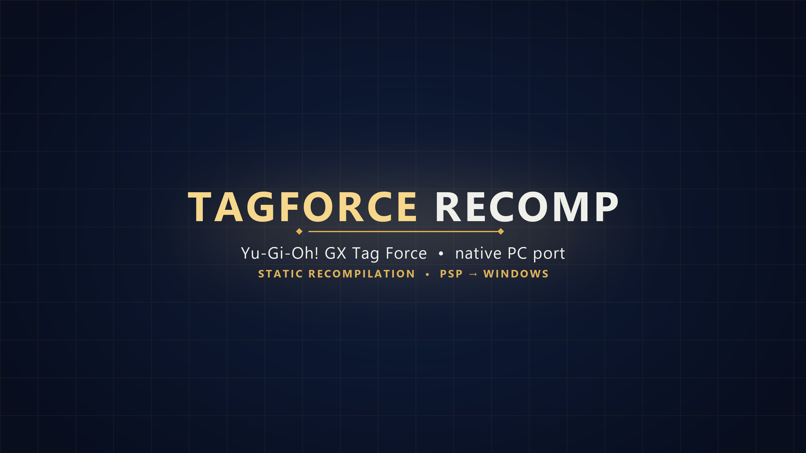

# Tag Force Recomp

<p align="center"></p>

Static recompilation of **Yu-Gi-Oh! GX Tag Force** (PSP, European release ULES00600 v1.01) to **native Windows**. The game's MIPS
(Allegrex) code is translated to C and runs on a custom runtime: HLE PSP kernel, GE (graphics chip) in software and on the GPU,
audio, video, I/O and windowing. The goal is a real **PC version** and a foundation for **mods**, including mods that change how
the game's AI plays and which decks the duelists use.

> **Legal notice.** This project is not affiliated with Konami and **contains no game data**: no code, textures, audio or video
> from the game. You need **your own legitimate copy** of the game (the ISO). It is read **once** to install the files into a
> local folder; everything derived from it (installed data, generated C code, executable, saves, logs) stays on your machine,
> outside Git. Yu-Gi-Oh! is a trademark of Konami and its licensors. See also [`THIRD_PARTY.md`](THIRD_PARTY.md).

> **Preview release.** This is an early public preview, not a finished product. It plays the game from start to finish in our
> testing, but it has had limited testing (mostly one machine, one game version and one save), some features are marked
> *experimental*, and **APIs, file formats, settings and folder names may still change without notice**. A ready-to-run zip is on
> the Releases page (see [Download and play](#download-and-play)); developers can also [build from source](#build-from-source-developers).
> Expect rough edges and please [report them](CONTRIBUTING.md#reporting-a-bug). See [`docs/PREVIEW.md`](docs/PREVIEW.md) for what is and is not covered.

## What works

The game runs end to end as far as it has been tested: title, New Game/Continue, Story Mode (3D field, island map, dialogue,
days, autosaves, story duels), full duels, Free Duel, Deck Edit, shop, Database, Options and Save Data. Full audio (SAS and
ATRAC3/3+) and H.264 movies through FFmpeg. Network/ad-hoc modes are not supported.

**Built as a PC game, not an imitation of the PSP UI:**
- Resizable window, fullscreen (F11 or Alt+Enter), dark theme, XInput controller, keyboard, native text box instead of the virtual keyboard.
- **Renderers**: Software (CPU), **Direct3D 11** or **Vulkan**, with **internal resolution from 1x to 8x**, configurable filter and aspect ratio.
- **High-resolution textures** (PPSSPP-format packs, compressed to BC7 on the GPU for a quarter of the memory), a **high-resolution font**
  and redrawn menu/dialog boxes in the **Enhanced Textures** pack. **F5** switches Original / Enhanced.
- **60 or 120 FPS by interpolation** (game logic stays at 30; the runtime creates the in-between frames) with a dedicated
  presentation thread (Vulkan), precise frame pacing and stable audio. Experimental.
- Configurable **sync mode** (default, VSync or lowest latency).
- Atomic saves, a log plus input recording of every session so problems can be replayed, and an optional
  **graphics diagnostic mode** that records screenshots during play (see [`docs/TESTING.md`](docs/TESTING.md)).

## Mods

The main download has **no mods**: it is as close to the original game as possible. Mods come separately: every one is a folder in `mods/`
(next to the exe), switched on or off on the launcher's **Mods** page (applies on restart). The release has a second file,
`TagForceRecomp-Mods-<version>.zip`, with all the behavior mods below (each starts switched off); copy its `mods` folder next to the exe.
There are three kinds of mod:

| Kind | What it does |
|---|---|
| Files | replaces files from the disc (text, data, movies) |
| Textures | replacement texture packs (PPSSPP format) |
| **Behavior (plugins)** | a `plugin.dll` that hooks game functions by address; stable, versioned API in [`plugins/sdk/tfmod.h`](plugins/sdk/tfmod.h) |

Behavior mods in this repository (sources in [`plugins/src/`](plugins/src/)):

| Mod | What it does |
|---|---|
| **Better AI** (`IAAprimorada`) | makes CPU duelists play better: adaptive posture, smarter summons/attacks/Dark Hole, and an optional **small language model** (bundled `llama.cpp` server) that picks among legal moves. See [`docs/AI.md`](docs/AI.md) |
| **Better Decks** (`DecksAprimorados`) | replaces the decks of duelists with edited ones, without touching the game files. See [`docs/DECKS.md`](docs/DECKS.md) |
| **CPU vs CPU** (`CPUvsCPU`) | lets the CPU play your side too; also the engine of the AI/deck test arena |
| **Booster box** (`CaixaDeBoosters`) | buy all remaining packs of a booster at once in the shop |
| **Cheats** (`Cheats`) | optional cheats in their own **Cheats** menu: see the CPU's cards (F6), DP multiplier (1x to 10x), fast-forward (1x to 8x, music keeps its pitch), unlock everything (cards, packs and Free Duel duelists) |
| **Card Randomizer** (`CardRandomizer`) | every deck of every duel is refilled with random cards from the whole card pool |
| **Player / Opponent Deck Randomizer** (`PlayerDeckRandomizer`, `OpponentDeckRandomizer`) | every duel, your / the opponent's deck becomes a random whole recipe of the game, with its own deck name; use one or both |
| **Monsters on the field** (`MonstrosNoCampo`) | *experimental prototype*: shows your face-up monsters larger over their zone |

Texture, video and button packs (HD menus, HD opening movie, EU cards, Xbox buttons) are separate mods distributed outside the repository.

The plugin API can read and write PSP memory and registers, call game functions, show message boxes over the screen and register
slider settings in the menu. See [`docs/MODS.md`](docs/MODS.md) to build your own.

## Download and play

1. Download `TagForceRecomp-<version>-win64.zip` from the [Releases](../../releases) page and extract it anywhere (not inside `Program Files`).
2. Run `TagForceRecomp.exe`, click **Select ISO...** and pick **your own** copy of the game (European release, ULES-00600).
3. Click **Install and play**. The first run copies the game files and translates the game's code on your machine (a few minutes,
   only once; the ISO is not needed afterwards). From then on just click **Play**.

Nothing needs to be installed: the zip carries the runtime, FFmpeg, a small C compiler (TinyCC) and the translator. It contains **no
game data and no game code**: the game's code is translated from your copy on your computer (`gen/`), compiled once (a few seconds,
kept in `gen/jitcache/`) and loaded in memory each time the game starts.

**Controls.** Keyboard and mouse (default PC layout): WASD or arrows; Space, E or left click = ✕; Backspace, C or right click = ○;
F = □; R = △; Q / Tab = L / R; Enter = START; Ctrl = SELECT; Shift = run; mouse wheel = up/down. The classic layout (arrows, Z = ✕,
X = ○, A = □, S = △, Q/W = L/R, Shift = SELECT) is used when **View > PC keyboard and mouse** is off. XInput controllers work too.
F11 / Alt+Enter: fullscreen · F3: FPS · F5: textures Original / Enhanced · F9: graphics diagnostic capture on/off · F8 (or F7): report a problem (asks for a note, then saves full-size screenshots, the last ~1.5 s of frames and the duel state; Esc or an empty note discards it) · controller quick marks (no note): L3 = graphics glitch, R3 = performance, Start + Select = audio (saves the last 8 s as a WAV) ·
Esc: leave fullscreen / asks before closing. The launcher's **Game** page lists the options; the window has no menu bar.

Saves live in `ms0/` next to the executable. Each run writes a log, the key presses and a copy of the save to `logs/`; any session can be
replayed with `tools/test/replay.sh` (developers). `tools/test/tf.py` plays the game by itself (buttons, screenshots, memory peek) for automated tests.

## Build from source (developers)

Requirements: Windows 10/11, [MSYS2](https://www.msys2.org/) UCRT64 (`gcc`, `g++`, `windres`, `glslc`, FFmpeg and Vulkan headers),
Python 3 with Pillow and numpy, Git Bash. **No Ghidra or any decompiler is needed.**

```sh
sh tools/build.sh                                     # the one build: incremental, into gen/pkg/TagForceRecomp/ (same layout as the release zip)
sh tools/install_dev.sh "D:/path/to/Tag Force.iso"    # first time only: installs the game data from your ISO (the code is translated on first run)
python tools/package_release.py                       # builds the release zip described above (gen/release/)
```

```powershell
.\gen\pkg\TagForceRecomp\TagForceRecomp.exe       # launcher: "Install and play" the first time (ISO); afterwards just "Play" (the ISO is no longer needed)
```

To check that the documented build works on a **clean Windows**, there is a one-click test in [Windows Sandbox](tools/test/teste_ambiente_limpo/README.md).

`TagForceRecomp.exe` can also install by itself (`TagForceRecomp.exe --install <iso>`) and verify the copy (`--verify <iso>`). What the project
translates is the code **of your copy**, on your machine; none of it is distributed.

## How it works

1. `tools/translator/` reads the game's modules and translates each Allegrex function to C (`recomp.py`, `allegrex.py`, `pspmod.py`).
2. The generated code, the runtime (`runtime/`) and FFmpeg are built into `TagForceRecomp.exe`.
3. The runtime implements in HLE what the PSP firmware would do (threads, files, audio, graphics, fonts) and presents the frames.
4. Plugins and mods connect through hooks on the recompiled functions and through file and texture replacement.

More detail in [`docs/ARCHITECTURE.md`](docs/ARCHITECTURE.md).

## Repository layout

Full map with every subfolder: [`docs/STRUCTURE.md`](docs/STRUCTURE.md).

| Folder | Contents |
|---|---|
| `tools/` | build, test and analysis scripts, plus the translator (Allegrex → C) in `tools/translator/` |
| `runtime/` | C++ runtime: HLE kernel, GE, GPU backends, audio, video, window, mods |
| `decomp/` | hand-written readable C++ replacing translated game functions one by one: title, story mode, map, duel result screen and more (see [`docs/DECOMP.md`](docs/DECOMP.md)) |
| `plugins/` | sources of behavior mods (`src/`) and their API header (`sdk/tfmod.h`) |
| `assets/` | branding images and the icon generator |
| `docs/` | documentation ([preview status](docs/PREVIEW.md), [mods](docs/MODS.md), [AI](docs/AI.md), [decks](docs/DECKS.md), [testing](docs/TESTING.md), [architecture](docs/ARCHITECTURE.md), [repository layout](docs/STRUCTURE.md), [game versions](docs/VERSIONS.md)) |
| `gen/` | everything that comes from your ISO (**not in Git**) |

## Contributing

Contributions are welcome: bug reports (with the log from `gen/logs/`), mods, fixes and ideas. See [`CONTRIBUTING.md`](CONTRIBUTING.md).
The most important rule: **no game data in the repository**.

## Credits

- HD texture pack used by many players: **MikeyMK** and **Filipe Ramos**.
- [PPSSPP](https://www.ppsspp.org/): reference for hardware behavior and the texture pack format (read-only reference, no code copied).
- [FFmpeg](https://ffmpeg.org/): video and ATRAC audio.
- [llama.cpp](https://github.com/ggml-org/llama.cpp): runs the small language model of the Better AI mod.

## License

[MIT](LICENSE) — you can use, fork, modify and redistribute this project freely, including for your own mods. The license covers the code and
documentation in this repository only; it does **not** cover the game, its data, or the third-party components listed in [`THIRD_PARTY.md`](THIRD_PARTY.md).
